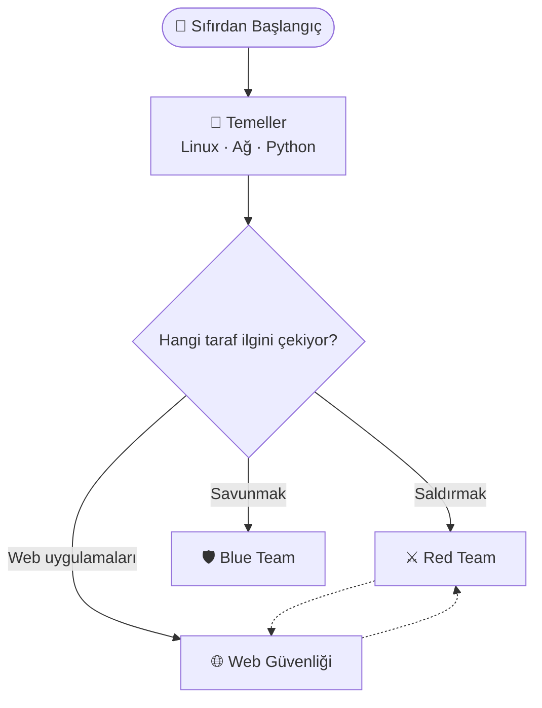

# 🗺️ Yol Haritaları

> "Neyi, hangi sırayla öğrenmeliyim?" sorusunun cevabı. Her yol haritası aşamalara bölünmüştür ve
> her aşama repodaki ilgili kaynaklara bağlanır.

| Yol Haritası | Kimin için? | Süre (tahmini) |
| ------------ | ----------- | -------------- |
| [🚀 Sıfırdan Başlangıç](sifirdan-baslangic.md) | Hiç bilgisi olmayanlar | 1–3 ay |
| [⚔️ Red Team / Pentest](red-team.md) | Temeli olup saldırı tarafına geçmek isteyenler | 6–12 ay |
| [🛡️ Blue Team / SOC](blue-team.md) | Temeli olup savunma tarafına geçmek isteyenler | 6–12 ay |
| [🌐 Web Güvenliği](web-guvenligi.md) | Web ve bug bounty'ye ilgi duyanlar | 4–8 ay |

> [!TIP]
> Yol haritasındaki kutucukları takip etmek için sayfanın içeriğini kendi notlarına (Obsidian, Notion veya
> kendi GitHub repona) kopyala ve tamamladıkça işaretle.

Yeni bir yol haritası eklemek istersen: [`sablonlar/roadmap-sablonu.md`](https://github.com/IUCYBER/awesome-iucyber/blob/main/sablonlar/roadmap-sablonu.md)
