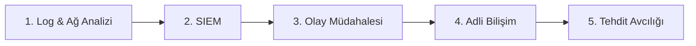

# 🛡️ Yol Haritası: Blue Team / SOC

> **Kimin için:** [Sıfırdan Başlangıç](sifirdan-baslangic.md) yol haritasını bitirmiş, savunma tarafına ilgi duyanlar
> **Tahmini süre:** 6–12 ay
> **Sonunda:** SOC L1 analist pozisyonuna başvurabilecek seviyede biri

---

## 1. Aşama: Log & Ağ Analizi

- [ ] Windows Event Log'ları (4624, 4625, 4688...)
- [ ] Linux logları (`/var/log`, `journalctl`)
- [ ] Wireshark ile şüpheli trafik analizi

📂 Kaynaklar: [Defansif Güvenlik → Olay Müdahalesi](../04-defansif-guvenlik/README.md#olay-müdahalesi--adli-bilişim)

## 2. Aşama: SIEM

- [ ] SIEM nedir, nasıl çalışır?
- [ ] Splunk veya Elastic ile temel sorgular
- [ ] Alarm (alert) triyajı

📂 Kaynaklar: [Defansif Güvenlik → SOC & SIEM](../04-defansif-guvenlik/README.md#soc--siem)

## 3. Aşama: Olay Müdahalesi

- [ ] Incident Response yaşam döngüsü (NIST)
- [ ] MITRE ATT&CK çerçevesi
- [ ] [LetsDefend](https://letsdefend.io/) alarm simülasyonları

## 4. Aşama: Adli Bilişim (DFIR)

- [ ] Disk ve bellek imajı alma
- [ ] Volatility ile bellek analizi

## 5. Aşama: Tehdit Avcılığı

- [ ] Hipotez tabanlı avcılık
- [ ] Sigma / YARA kuralları yazma

📂 Kaynaklar: [Lab Platformları](../04-defansif-guvenlik/README.md#lab-platformları)

---

## ✅ Bu aşamayı bitirdiğini nasıl anlarsın?

- Bir alarmı alıp "true/false positive" kararını gerekçesiyle verebiliyorsun
- Bir saldırıyı MITRE ATT&CK teknikleriyle eşleyebiliyorsun
- CyberDefenders'da en az 5 lab tamamladın
