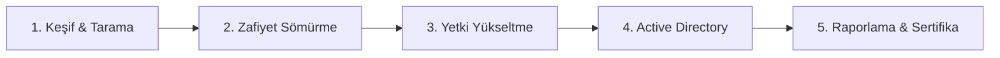

# ⚔️ Yol Haritası: Red Team / Pentest

> **Kimin için:** [Sıfırdan Başlangıç](sifirdan-baslangic.md) yol haritasını bitirmiş, saldırı tarafına ilgi duyanlar
> **Tahmini süre:** 6–12 ay
> **Sonunda:** HTB "Easy/Medium" makinelerini çözebilen, eJPT/PNPT seviyesinde biri

---

## 1. Aşama: Keşif & Tarama

- [ ] `nmap` (servis/versiyon tespiti, NSE scriptleri)
- [ ] Dizin/subdomain keşfi (`gobuster`, `ffuf`)
- [ ] Pasif keşif / OSINT temelleri

📂 Kaynaklar: [Ofansif Güvenlik → Giriş](../03-ofansif-guvenlik/README.md#giriş) · [OSINT](../08-osint/README.md)

## 2. Aşama: Zafiyet Sömürme

- [ ] Metasploit temelleri
- [ ] Public exploit bulma ve düzenleme (Exploit-DB, searchsploit)
- [ ] Temel web açıkları (SQLi, dosya yükleme, LFI)

📂 Kaynaklar: [Web Güvenliği](../02-web-guvenligi/README.md)

## 3. Aşama: Yetki Yükseltme

- [ ] Linux privesc (SUID, sudo, cron, kernel)
- [ ] Windows privesc (servisler, token, registry)

📂 Kaynaklar: [Ofansif Güvenlik → Privilege Escalation](../03-ofansif-guvenlik/README.md#privilege-escalation)

## 4. Aşama: Active Directory

- [ ] Kerberos temelleri
- [ ] Kerberoasting, AS-REP roasting, Pass-the-Hash
- [ ] BloodHound

📂 Kaynaklar: [Ofansif Güvenlik → Active Directory](../03-ofansif-guvenlik/README.md#active-directory)

## 5. Aşama: Raporlama & Sertifika

- [ ] Bir pentest raporu yaz (çözdüğün bir makine için)
- [ ] Hedef sertifikayı seç

📂 Kaynaklar: [Sertifikalar & Kariyer](../10-sertifikalar-kariyer/README.md)

---

## ✅ Bu aşamayı bitirdiğini nasıl anlarsın?

- HTB'de rehbersiz en az 10 "Easy" makine çözdün
- Bir AD lab ortamında domain admin olabildin
- Yazdığın raporu başkası okuyup aynı adımları tekrarlayabiliyor
