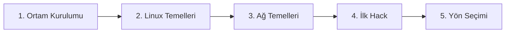

# 🚀 Yol Haritası: Sıfırdan Başlangıç

> **Kimin için:** Hiç bilgisi olmayan, "nereden başlayacağım?" diyenler
> **Tahmini süre:** 1–3 ay (haftada ~5–8 saat)
> **Sonunda:** Linux terminalinde rahat, ağ temellerini bilen, ilk makinelerini çözmüş biri

---

## 1. Aşama: Ortam Kurulumu `~1 hafta`

- [ ] VirtualBox kur
- [ ] [Kali Linux'u sanal makineye kur](https://www.kali.org/docs/virtualization/install-virtualbox-guest-vm/)
- [ ] Not alma düzeni kur (Obsidian / Notion)

📂 Kaynaklar: [Başlangıç Paketi → Kurulumlar](../00-baslangic/README.md#kurulumlar)

## 2. Aşama: Linux Temelleri `~2–3 hafta`

- [ ] Dosya sistemi, `cd`, `ls`, `cat`, `grep`, `find`
- [ ] Kullanıcılar, izinler (`chmod`, `chown`, `sudo`)
- [ ] [OverTheWire Bandit](https://overthewire.org/wargames/bandit/) 0–20

📂 Kaynaklar: [Temeller → Linux](../01-temeller/README.md#linux)

## 3. Aşama: Ağ Temelleri `~2–3 hafta`

- [ ] OSI & TCP/IP modelleri
- [ ] IP, subnet, port, protokoller (HTTP, DNS, SSH, FTP)
- [ ] Wireshark ile trafik inceleme

📂 Kaynaklar: [Temeller → Ağ](../01-temeller/README.md#ağ-network)

## 4. Aşama: İlk Hack `~2–4 hafta`

- [ ] [The Cyber Mentor kursu Part 1](https://youtu.be/3FNYvj2U0HM)
- [ ] [TryHackMe: Intro to Offensive Security](https://tryhackme.com/module/introduction-to-offensive-security)
- [ ] [Hack The Box: Starting Point](https://app.hackthebox.com/starting-point) Tier 0

📂 Kaynaklar: [CTF & Pratik](../05-ctf-ve-pratik/README.md)

## 5. Aşama: Yön Seçimi

- [ ] Saldırı mı, savunma mı, web mi? → [Yol Haritaları](README.md)

---

## ✅ Bu aşamayı bitirdiğini nasıl anlarsın?

- Bandit'i en az 20. seviyeye kadar geçtin
- Bir makineyi `nmap` taramasından başlayarak çözebiliyorsun
- "Port 80 açık" ne demek, birine anlatabiliyorsun
