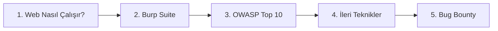

# 🌐 Yol Haritası: Web Güvenliği & Bug Bounty

> **Kimin için:** Web uygulamalarına ve bug bounty'ye ilgi duyanlar
> **Tahmini süre:** 4–8 ay
> **Sonunda:** PortSwigger Academy'de "Practitioner" lab'larını çözebilen, ilk bug bounty programına hazır biri

---

## 1. Aşama: Web Nasıl Çalışır?

- [ ] HTTP istek/yanıt, metodlar, header'lar, status kodları
- [ ] Cookie, session, CORS, Same-Origin Policy
- [ ] Temel HTML/JavaScript okuyabilmek

📂 Kaynaklar: [Web Güvenliği → Teori](../02-web-guvenligi/README.md#teori)

## 2. Aşama: Burp Suite

- [ ] Proxy, Repeater, Intruder kullanımı

## 3. Aşama: OWASP Top 10

- [ ] SQL Injection
- [ ] XSS (Reflected, Stored, DOM)
- [ ] Broken Access Control / IDOR
- [ ] Authentication açıkları

📂 Kaynaklar: [PortSwigger Academy](https://portswigger.net/web-security) · [OWASP Top 10](https://owasp.org/www-project-top-ten/)

## 4. Aşama: İleri Teknikler

- [ ] SSRF, XXE, SSTI
- [ ] Insecure Deserialization
- [ ] Race condition, business logic açıkları

## 5. Aşama: Bug Bounty

- [ ] Writeup okuma alışkanlığı (haftada 3+)
- [ ] Recon metodolojisi oluşturma
- [ ] İlk programa katıl (VDP / düşük rekabetli programlar)

📂 Kaynaklar: [Web Güvenliği → Bug Bounty](../02-web-guvenligi/README.md#bug-bounty)

---

## ✅ Bu aşamayı bitirdiğini nasıl anlarsın?

- PortSwigger'daki tüm "Apprentice" lab'larını bitirdin
- Bir açığı, etkisini anlatan net bir raporla yazabiliyorsun
