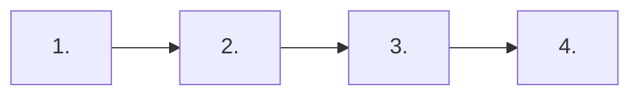

<!--
  YENİ YOL HARİTASI ŞABLONU
  1. Bu dosyayı docs/roadmaps/<alan-adi>.md olarak kopyala
  2. <...> ile işaretli yerleri doldur
  3. docs/roadmaps/README.md tablosuna ve mkdocs.yml'deki nav'a ekle
  Mermaid diyagramı GitHub'da otomatik olarak çizilir: https://mermaid.js.org/syntax/flowchart.html
-->

# <emoji> Yol Haritası: <Alan Adı>

> **Kimin için:** <Ön koşul / hedef kitle>
> **Tahmini süre:** <X–Y ay>
> **Sonunda:** <Bu yolu bitiren kişi ne yapabilir?>

---

## 1. Aşama: <Aşama Adı> `~<süre>`

- [ ] <Öğrenilecek konu>
- [ ] <Öğrenilecek konu>

📂 Kaynaklar: [<Kategori → Bölüm>](../<kategori>/README.md#<bolum>)

## 2. Aşama: <Aşama Adı> `~<süre>`

- [ ] <Öğrenilecek konu>

📂 Kaynaklar: [<Kategori → Bölüm>](../<kategori>/README.md#<bolum>)

---

## ✅ Bu aşamayı bitirdiğini nasıl anlarsın?

- <Ölçülebilir hedef>
- <Ölçülebilir hedef>
